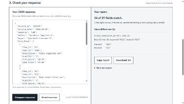

# AI Extraction Checkup

A free, local browser exercise for **one synthetic practice invoice**. Give
the included PDF and extraction instruction to an AI tool of your choice,
paste its JSON response, and inspect exact differences against a checked
answer. Copy or download a readable plain-text report.

For developers and automation builders learning invoice-to-JSON extraction.
Practise checking whether a response preserved each printed row, identifier
and amount, with formatting and unreadable values explained separately.
You need an AI tool that accepts the supplied PDF or image; Checkup does not
run a model or require an API key or signup of its own.

AI Toolcast owns this tool and used AI assistance in its development and review; the checker makes no model calls, and you choose a separate AI service for extraction.

[Use the hosted tool](https://aitoolcast.com/tools/extraction-checkup/?utm_source=github&utm_medium=referral&utm_campaign=free-tool-launch)
· [Source repository](https://github.com/AIToolcast/extraction-checkup)
· [AI Toolcast](https://aitoolcast.com/)

This is an educational pilot, not a model benchmark or a checker for your
own invoices. It makes no provider calls and has no customer-document
uploads, accounts, custom schemas, stored response history or paid features.
Release **0.1.0** uses comparison rules **1.0.0**.



The screenshot deliberately changes one identifier in the supplied control.
It is a prepared demonstration, not an observed model failure.

## Use the exercise

1. Download or view the [synthetic practice invoice](fixture/synthetic-invoice-000147.pdf).
2. Supply that invoice and the exact [extraction instruction](EXTRACTION_PROMPT.md)
   to your chosen AI tool. The [response schema](response-schema.json) is optional.
3. Paste the returned JSON and choose **Compare response**. Inspect the
   expected and received values, then copy or download the report.

The [checked answer](fixture/answer.json) is inspectable. Avoid opening it or
the built-in examples first if you want a blind exercise. Six labeled
synthetic controls demonstrate a match, harmless whitespace/reordering,
a missing row, a changed ID, swapped quantities and a wrong total. They are
prepared test inputs, not observed AI failures.

## Run locally

No package installation is needed to run the tool. Serve this directory over
HTTP; opening `index.html` directly as a file will not reliably load modules
or example files. With Python 3, from this directory:

```sh
python -c "import http.server; http.server.SimpleHTTPRequestHandler.extensions_map['.mjs']='text/javascript'; http.server.test(HandlerClass=http.server.SimpleHTTPRequestHandler,bind='127.0.0.1',port=8788)"
```

Open <http://localhost:8788/?qa=1>. The explicit MIME mapping also covers
Windows systems whose default HTTP server labels `.mjs` as plain text. A
normal static host can serve the same files with the JavaScript MIME type.

The page uses relative URLs for its assets, so it also works at a nested
route such as `/tools/extraction-checkup/`. The self-hosted fonts and brand
files are included in `assets/`.

## Run the checks

Node's built-in test runner checks the fixed comparator:

```sh
node --test compare.test.mjs
```

The focused UI check uses Python and Playwright with Chromium, installed in
the development environment. These are development-only dependencies:

```sh
python tests/browser_ui.py
```

It starts a temporary local server and verifies the six controls, malformed
and oversized inputs, safe report rendering, exact clipboard and downloaded
file contents, reset, keyboard focus and 1440/390/320-pixel layouts. The UI
test substitutes a small tracking stub to inspect event arguments; it does
not verify a hosted collection service or constitute independent release
review.

The comparator also works without the interface:

```js
import { compareInvoice, reportText } from './compare.mjs';

const result = compareInvoice(pastedJsonText);
const plainText = reportText(result);
```

`compareInvoice` accepts JSON **text**, so duplicate keys cannot disappear
before they are checked. It returns a new report without changing the fixed
answer or retaining a previous submission. `reportText` produces plain text.
The browser renders every finding through `textContent`, never `innerHTML`.

## Comparison rules 1.0.0

Fixture: `synthetic-invoice-000147`, visibly fictional, dated October 19,
2026. The document total is USD 147.47. There are 13 invoice-level scalar
fields and four rows with six fields each: 37 scalar checks. `fixture.mjs`
contains the frozen checked answer, not an extraction model's output.

| Input or field | Rule |
|---|---|
| Input | One JSON object, no comments, fences or trailing commas. At most 65,536 UTF-16 code units and 16 nested containers. |
| Object members | Duplicate keys are rejected before comparison, including duplicates spelled using JSON escapes. Names may repeat in different objects. Unexpected fields are separate extra-field findings. |
| Scalar types | Use strings. A number, boolean, array or object is a format/type deviation, with no guessed semantic verdict. |
| Missing/uncertain data | Required fields may be null to disclose uncertainty. Null, absent or blank values never pass; they are reported as missing/uncertain, not fabricated values. |
| Row alignment | Match by unique, trimmed printed line_id. Ignore array order. Do not align by position, coerce numeric IDs or add missing zeroes. |
| Duplicate row IDs | Report ambiguity and compare none of the conflicting rows. Do not pick the first or last row as the answer. |
| Missing/extra rows | Report the affected line ID. This exercise expects 01–04. More than 20 submitted rows is a bounded-input error; row comparison stops. |
| IDs and currency | Compare exact characters after trimming surrounding whitespace. Leading zeroes, punctuation and case remain meaningful. |
| Descriptive text | Trim surrounding whitespace and collapse internal whitespace in seller, buyer and description. Preserve words, punctuation and case. |
| Date | Require a real calendar date in YYYY-MM-DD format, then compare it with the fixture date. Do not reinterpret alternate date formats. |
| Numeric strings | Compare exact decimal strings after normalization, without floating-point conversion or a tolerance. No currency symbols, grouping commas, units, percentages or exponent notation. |
| Money | Require two fractional digits. An equivalent value such as 147.4700 is a format deviation, not a wrong-value finding. |
| Rates and quantities | Use unsigned plain decimal text without extra leading zeroes. Rates are fractions, not percentage strings. Equivalent trailing zeroes are permitted. |
| Discount | discount_amount is the **positive amount to subtract**, despite the printed negative adjustment. The known -14.40/14.40 distinction receives a specific representation-rule explanation. It is not presented as a general AI error. |

The response schema describes keys, types and nullable uncertainty; it does
not establish complete semantic correctness. The comparator enforces the
rules above and matches this fixture's values. It does not recompute
arbitrary invoice tax or certify accounting correctness.

Results distinguish `value`, `format`, `missing`, `extra`, `structure` and
invalid `input` findings. A missing row is one row finding rather than six
repeated messages. Malformed JSON receives no matched-field count. Only a
result with no findings is `match`; matching all expected values while
supplying extra fields still does not pass the contract.

The report identifies the fixture, rule version and generation time.
Matched-field counts describe this fixed exercise, **not an accuracy
percentage, provider ranking or prediction about real documents**. Expected
and received values are quoted as data.

## Privacy and measurement

Comparison runs in the browser. Pasted JSON, field values and report text
are not sent to AI Toolcast or an AI provider. This tool does not store
response history. The AI service you choose for extraction has its own data
policy. Copying puts text on your device's clipboard; downloading creates a
plain-text file in your browser's normal download flow.

Hosted builds can collect limited action events: arrival, practice download,
comparison start/completion, report copy and report export. These events
contain no pasted input, document text or report content. A completion means
the checker generated a valid comparison report; a report containing
differences still counts as a completed check. Invalid JSON does not.
An export event means a download was **initiated**, not that the operating
system confirmed a saved file. These are tool actions, not measured demand
or unique people.

Hosted referral measurement uses a fixed source category, including
NoUploadTools and Supatools when the browser supplies their referrer or an
allowlisted source tag. Raw referring URLs, search text and arbitrary campaign
values are not sent. These directory labels apply prospectively after the
site's attribution update; older direct/other counts are not reclassified.
Missing referrers, redirects, a new tab or privacy opt-outs can hide a referral.
This is optional event measurement, not proof of an individual visitor or sale.

Built-in samples are marked separately and excluded from reader-use counts,
including edited samples until the exercise is reset. `?qa=1` disables tool
event collection for operator checks. `?tracking_test=1` is reserved for
collection verification and marks those events as QA. The interface remains
usable if the optional tracking module or service is unavailable. The
[site privacy notice](https://aitoolcast.com/privacy/) covers hosting and
site analytics separately.

## Optional collector source

`usage.mjs` is disabled on local/preview origins and with `?qa=1`; the
exercise works without event collection. The included Pages Function and
`scripts/usage-schema.sql` show the optional hosted collector contract. The
schema is for a fresh database: `CREATE TABLE IF NOT EXISTS` does not update
an existing table’s constraints. This export provides no production database
migration, deployment credentials, account binding or deployment command.
Use a separately reviewed migration for an existing installation.

Run the client/API/fresh-schema checks with:

```sh
node --test scripts/check_usage.mjs
```

## Worked examples

[Trace identifiers through CSV import](examples/csv-identifier-boundary/README.md)
reuses the original synthetic invoice to locate a downstream type conversion.
Recorded Python/pandas execution is separate from AI extraction and Excel testing.

## Provenance, license and support

AI Toolcast created the original invoice, checked its arithmetic and layout,
and wrote this comparator and interface. No competitor implementation was
copied. Original file hashes are recorded in [fixture/README.md](fixture/README.md).
The clarified extraction instruction applies to this exercise; it should
not be applied retroactively to earlier work with different instructions.

Original code, documentation and synthetic fixtures are available under the
[MIT license](LICENSE). The bundled AI Toolcast Sans, Mono and Display font
derivatives use new internal family names. They derive from IBM Plex and
Fraunces and retain the original SIL Open Font License, copyright and
Reserved Font Name notices and provenance in `assets/fonts/`.

For broader evaluation work, consider
[Omni Extract Bench](https://github.com/datalab-to/omni_extract_bench) or
[EvalLens](https://www.rendonarango.com/eval-lens). Their comparison policies
and scope differ; this project offers a complete, fixed practice exercise.

Support is limited to reproducible defects in this exercise. Report them in
[repository issues](https://github.com/AIToolcast/extraction-checkup/issues)
with browser details and a synthetic example. Do not post private documents,
credentials or customer data. General invoice support, feature requests,
response times and continuing updates are not guaranteed.

## Changelog

- **0.1.0** — One synthetic invoice; explicit comparison rules 1.0.0; exact
  instruction and schema; pasted JSON; grouped, safely rendered findings;
  six labeled controls; reset; plain-text report copy/download; optional
  usage-event integration.
